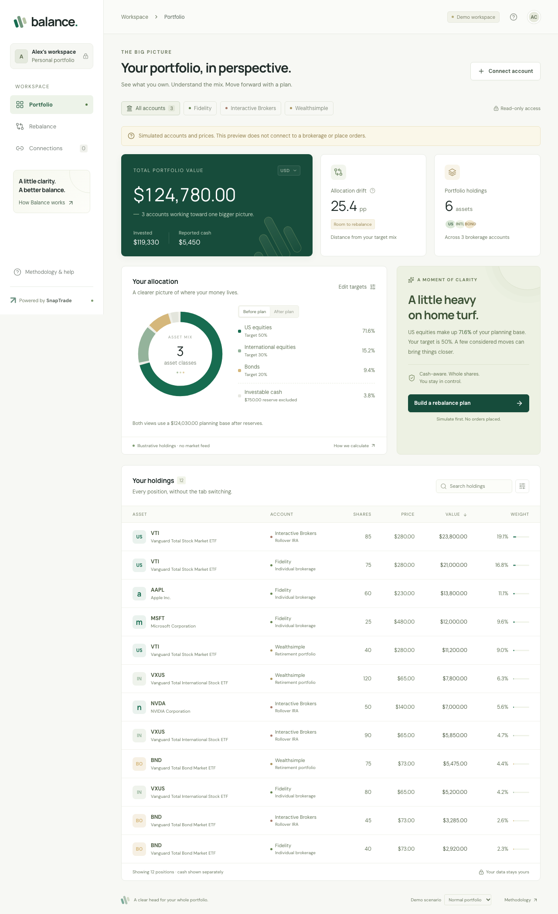

# BALANCE

**A clearer way to rebalance a portfolio spread across brokerage accounts.**

[Public site](https://balance-snaptrade.vercel.app) · [Sample workspace](https://balance-snaptrade.vercel.app/demo) · [Architecture](docs/architecture.md) · [Deployment and verification](docs/submission.md)

BALANCE turns an investor’s target allocation into an explainable, account-funded rebalancing simulation. Cash stays with its own account, proposed trades use whole shares, and taxable sales require an explicit choice. Every result shows its remaining drift and funding assumptions.

Built for the [SnapTrade Product Engineer application](https://careers.snaptrade.com/product-engineer).



## Product walkthrough

- **`/`** explains the product, supported portfolios, and data controls.
- **`/app`** opens a private SnapTrade workspace. Sign-in, loading, expired-session, and unavailable-data states never substitute fictional holdings.
- **`/demo`** is an explicit sample workspace. It uses fixed illustrative data, saves sample preferences and plans in this browser, and makes no private API requests.
- **`/privacy`** explains storage, retention, deletion, and disconnect behavior.

In a connected workspace, review your targets, cash reserve, asset classifications, and account tax treatment before saving your first policy. Save later changes explicitly. Preferences follow the verified SnapTrade identity across sessions; hypothetical contributions belong to individual scenarios.

The planner shows proposed moves, before/after allocation, residual cash, and an account funding ledger. Save a named plan to preserve its original holdings, prices, source timestamps, policy, and result. Historical snapshots stay read-only when current prices or preferences change and have a separate historical CSV export. Connected workspaces support up to 30 saved plans; the sample workspace supports 25 local plans.

Connect or repair brokerages through your **SnapTrade Personal dashboard**, then return to reload available snapshots. Balance requests `openid read` and never places orders or moves money.

## Run locally

Requires Node.js 22 and npm.

```sh
npm ci
cp .env.example .env.local
npm run dev
```

Open [localhost:3000](http://localhost:3000), then choose the sample workspace. No SnapTrade credentials are needed for `/demo`.

For connected accounts, register an OAuth app under **Commercial workspace → OAuth Apps** in the [SnapTrade Dashboard](https://dashboard.snaptrade.com). Set `SNAPTRADE_CLIENT_ID`, `SNAPTRADE_CLIENT_SECRET`, `SESSION_ENCRYPTION_KEY`, and `APP_URL` in `.env.local`. These must be OAuth app credentials, rather than a Commercial API `clientId`/`consumerKey` pair. Register `APP_URL` plus `/api/auth/callback` exactly. A separate Personal workspace supplies the accounts authorizing access.

Generate the encryption key with `openssl rand -base64 32`. Production requires a Postgres `DATABASE_URL` and all three SQL migrations, applied in order. Local development can explicitly use `SESSION_STORE=memory` with no database; its server data disappears on restart. See the [setup guide](docs/submission.md) for exact configuration and verification steps.

## Scope and boundaries

Live planning supports USD stock and ETF accounts with complete, recent data. Unknown holdings and account tax treatment require user confirmation; saving those confirmations preserves them for subsequent visits. Missing prices, stale data, unsupported instruments, and inconsistent currencies continue to block planning.

The planner buys only eligible securities already held in each selected account. It is a bounded deterministic heuristic, with no guarantee of the mathematically best allocation. Fees, realized taxes, spreads, settlement, margin, FX conversion, and execution prices are outside the model. See the [calculation contract](docs/architecture.md).

## Verification

Local verification on October 14, 2026: **184 unit/integration tests and 10 migration tests**, including real disposable PostgreSQL checks, and **36 Chromium browser tests**. Browser coverage includes onboarding, persistence, historical provenance, failure recovery, mobile layout, and automated WCAG A/AA checks using axe.

```sh
npm run typecheck
npm test
npm run test:migrations
npm run build
npx playwright install chromium
npm run test:e2e
```

Postgres tests require `TEST_DATABASE_URL` pointing to a disposable loopback database named `balance_test…`; otherwise those checks skip. GitHub Actions provisions that database and runs the full verification workflow. Browser tests use port 3001 and controlled API fixtures for connected flows. Set `CAPTURE_SCREENSHOTS=1` to refresh the sample screenshots.

**Real SnapTrade OAuth authorization and deployed database persistence remain pending verification.** The public URL and successful automated checks do not establish those properties. Complete the [live release checks](docs/submission.md) before describing the connected product as verified.

## Stack

Next.js, React, TypeScript, Node.js 22, and Postgres. OAuth credentials, workspace policies, saved financial snapshots, and the 45-second session snapshot cache are encrypted on the server. The pure planner is separate from the integration and interface.
